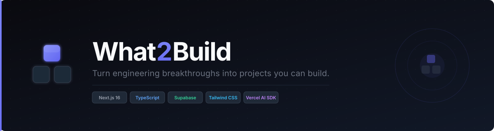
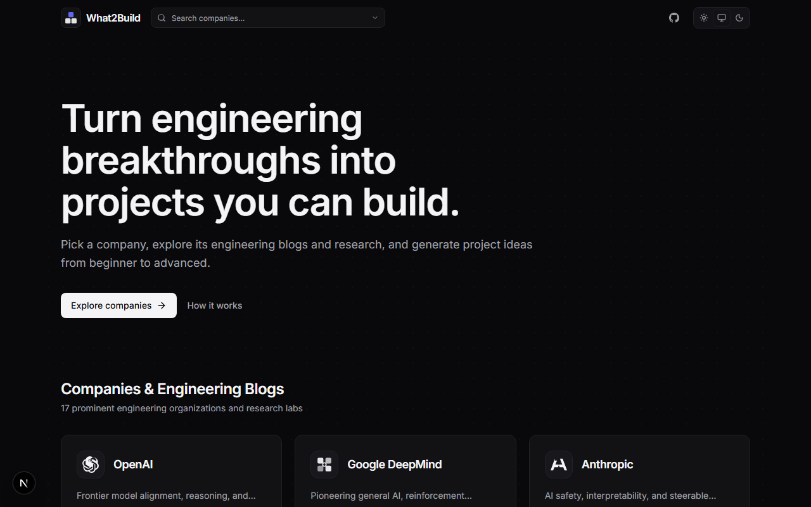
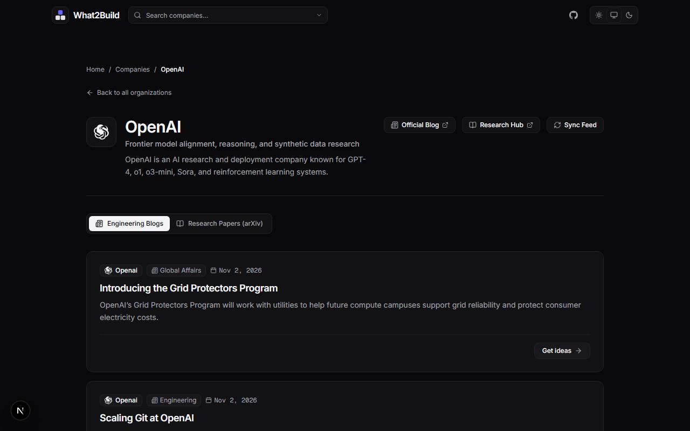
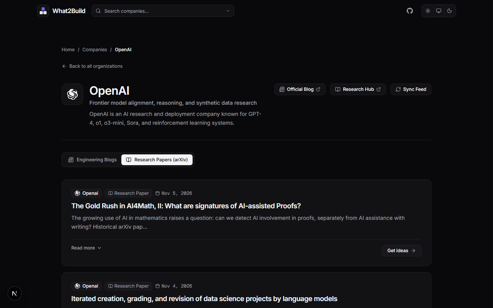
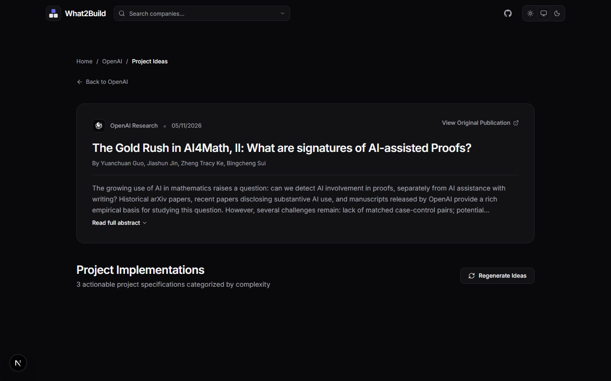

<p align="center">
  
</p>

<p align="center">
  <strong>What2Build</strong> is an open engineering portal that bridges frontier AI research with real-world software development.<br/>
  Pick a lab, browse its latest papers and engineering blogs, and instantly generate three tiered project ideas—from beginner PoC to advanced agentic architecture.
</p>

<p align="center">
  <a href="https://github.com/saipy10/What2Build/stargazers"></a>
  <a href="https://github.com/saipy10/What2Build/blob/main/LICENSE"></a>
  
  
  
</p>

---

## 📸 Screenshots

<table>
  <tr>
    <td align="center" width="50%">
      
      <br/><sub><b>Homepage — Hero &amp; Company Grid</b></sub>
    </td>
    <td align="center" width="50%">
      
      <br/><sub><b>Company Hub — Engineering Blogs</b></sub>
    </td>
  </tr>
  <tr>
    <td align="center" width="50%">
      
      <br/><sub><b>Research Papers (arXiv) Tab</b></sub>
    </td>
    <td align="center" width="50%">
      
      <br/><sub><b>AI-Generated Project Ideas</b></sub>
    </td>
  </tr>
</table>

---

## 🌟 Key Features

1. **Frontier AI Organization Directory**:
   - OpenAI, Google DeepMind, Anthropic, NVIDIA, Meta AI, and 12 more engineering orgs.
   - Shows company taglines, research scope, and links to official publication portals.

2. **Automated Live Research Paper Discovery**:
   - Connects to arXiv and official publication metadata feeds.
   - Retrieves the 10 latest papers per company with titles, abstracts, authors, publication dates, and original URLs.
   - Deduplication and 24-hour cache invalidation strategy.
   - Manual instant refresh capability.

3. **AI Software Project Generation**:
   - Generates exactly 3 distinct software projects per paper:
     - **Idea 1**: Direct implementation / reproducible benchmark / visual playground.
     - **Idea 2**: Applied production system or microservice.
     - **Idea 3**: Advanced or agentic frontier experiment.
   - Formatted with concrete features, demonstrated skills, suggested technology stack, difficulty level, and research connections.
   - Validated through Zod schemas.
   - Caching with an explicit **Regenerate Ideas** trigger.

4. **Modern Developer-Centric UI**:
   - Dark theme default with deep charcoal backgrounds, minimal accents, and accessible typography.
   - Responsive design for mobile, tablet, and desktop.
   - Comprehensive error, empty, and loading states.

---

## 🚀 Tech Stack

- **Framework**: Next.js 16 (App Router)
- **Language**: TypeScript
- **Styling**: Tailwind CSS
- **Backend / Database**: Supabase (`@supabase/supabase-js`, `@supabase/ssr`)
- **AI SDK**: Vercel AI SDK (`ai`, `@ai-sdk/openai`) & Zod
- **Icons**: Lucide React
- **Parser**: `fast-xml-parser` & `cheerio`

---

## 🛠️ Getting Started

### 1. Prerequisites
- Node.js (v20 or newer recommended)
- A [Supabase](https://supabase.com) project
- (Optional) Groq / OpenAI API Key

### 2. Installation

Clone the repository and install dependencies:

```bash
npm install
```

### 3. Environment Setup

Copy `.env.example` to `.env.local`:

```bash
cp .env.example .env.local
```

Configure your environment variables in `.env.local`:

```env
# Supabase Credentials
NEXT_PUBLIC_SUPABASE_URL="https://<your-project-id>.supabase.co"
NEXT_PUBLIC_SUPABASE_PUBLISHABLE_KEY="sb_publishable_<your-key>"

# LLM Providers (Optional - deterministic generator used if omitted)
GROQ_API="your-groq-api-key"
OPENAI_API_KEY="your-openai-api-key"
OPENAI_MODEL="gpt-4o-mini"
```

> **Note**: If LLM API keys are omitted, What2Build automatically uses its built-in intelligent generator to synthesize grounded project ideas tailored to the paper context.

### 4. Running the Application

Start the development server:

```bash
npm run dev
```

Open [http://localhost:3000](http://localhost:3000) in your browser.

---

## 🏛️ Architecture & Decisions

- **Crawler Strategy**: We implement an official arXiv query engine using institutional identifiers and publication query syntax for each company, combined with structured metadata normalization. This prevents fragile HTML scraping breakage across corporate redesigns while guaranteeing access to the latest research preprints.
- **Backend & Database**: Supabase provides serverless database and auth capabilities via `@supabase/ssr` with client/server utility wrappers in `src/utils/supabase/`.
- **AI Generation Engine**: Uses structured object generation (`generateObject`) backed by Zod schemas to enforce strict JSON contracts for generated project ideas.
